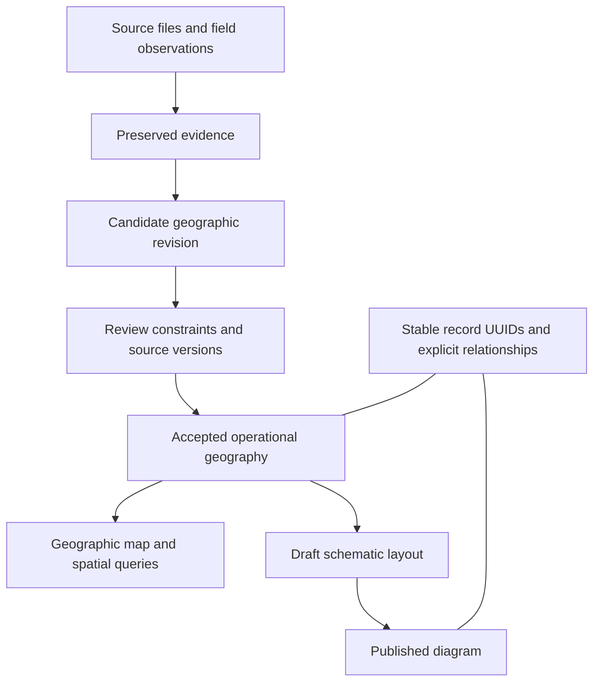

---
---

# Geometry model proposal

Status: Proposed, November 21, 2026. The storage and editing workflows below
require implementation and review before use. Current behavior is identified
separately. [ADR 0220](adr/0220-evidence-operational-and-schematic-geometry.md)
records the technical proposal, migration boundaries and acceptance criteria.

Keep measured or reported locations as evidence, maintain reviewed geographic
polygons for cemetery operations, and give readable diagrams their own layout.
Connect these representations through the existing record UUIDs. Moving a shape
in one representation must be an explicit action on that representation.

## Three related representations

| Representation | Purpose | What a change means |
| --- | --- | --- |
| Location evidence | Original marker observations, source GIS features, scans and field measurements, with their source and accuracy limitations. | Add a new observation or documented correction while preserving the previous evidence. |
| Operational geography | The currently accepted geographic marker location and lot/gravesite footprints used by the application. Polygons may remain estimated. | Publish a reviewed revision of a working location or footprint. |
| Schematic layout | A readable arrangement of the same records within a named diagram. | Change the presentation while keeping geographic coordinates and record relationships intact. |

A diagram edit has no return path that silently changes operational geography.
Evidence can support a different footprint later, through a new geographic review.

## What exists today

Markers have EPSG:4326 point geometry, latitude/longitude fields and source
properties. Some points are imported GPS locations; others are estimates, as
documented in [ADR 0098](adr/0098-add-weitzel-estimated-monument.md). The
[source register](data-sources.md#headstone-gps-coordinates-and-burial-names)
still lists the spreadsheet's collection method and accuracy as TBD. Neither
the number of decimal places nor a GPS label establishes survey accuracy.

Lots and gravesites already have `geometry_type`, `geometry_source`,
`geometry_confidence` and `geometry_notes`. These classify one stored geographic
polygon; they do not provide three independently versioned representations.
Some current lot polygons are explicitly labeled schematic. The existing
**Diagram** mode emphasizes those polygons and hides external layers while using
the same underlying geographic coordinates. It is not a separate editable layout.

The spreadsheet importer generates approximate boxes around marker points.
Reviewed migrations have subsequently split, shifted and assigned records.
The [spatial repair preview](adr/0194-local-database-review-tools.md) creates
read-only candidates and has no apply command. Those capabilities remain the
baseline while the proposed model is evaluated.

## Marker observations and accepted locations

Preserve the original coordinate, source reference, coordinate system, observation
date and method. Record accuracy when supplied, including what that accuracy
number means; otherwise label it unknown. A camera's GPS position belongs to the
photo observation and does not automatically become the photographed marker's
location. Estimated marker positions remain explicitly estimated.

Select an accepted location from reviewed observations or a documented derivation.
A new field reading, a transcription correction and a physically relocated marker
are different events, each retaining the earlier record. Keep marker coordinates
fixed during polygon alignment. If a point appears wrong, review its evidence
instead of moving it to make nearby polygons look tidy.

## Working lot and gravesite footprints

Use polygons to represent the best supported operational interpretation, with
source lineage, estimation method and review status visible. A reviewed estimate
is still an estimate. A marker at a grave's edge, a shared monument, a footstone
and a nearby marker require different relationship interpretations.

Keep lot assignments, marker links, ownership and stack levels explicit.
Containment and proximity are review signals rather than automatic assignments.
For example, the [C-0384 assignment](adr/0211-assign-c0384-to-c88.md) changes the
registry-backed lot relationship without moving its polygon or marker. Stacked
graves can legitimately overlap in two dimensions. A gap may be a passageway,
reserved area or uncertainty; it is not proof of an available grave.

For row alignment, define reviewed anchors and an axis, then generate all proposed
positions from a common origin. Show before/after footprints, marker offsets,
changed dimensions, overlaps, parent boundaries and neighboring records. Avoid
accumulating one small offset from each preceding grave. The reviewer must see
the whole run and any exceptions before publication.

## Schematic layouts

Store a diagram as a named, versioned view with its own local coordinate space,
units, orientation, extent and linked record UUIDs. It may show rows evenly spaced
or separate stacked graves for selection. That separation changes the drawing,
not their physical location or authorization. A marker's diagram symbol is a
display position rather than another field observation.

Use a dedicated diagram canvas or SVG surface for local coordinates. Keep GPS
overlays, geographic distance tools and map exports tied to geographic data.
GeoJSON geographic coordinates use WGS84 longitude/latitude; arbitrary diagram
coordinates need a distinct payload and must not be passed off as geographic
GeoJSON. See [RFC 7946](https://www.rfc-editor.org/rfc/rfc7946.html#section-4).
Historic scans remain source evidence; a geographic overlay requires a reviewed
registration with control points and recorded residuals. Publishing a diagram
does not establish that registration.

## Proposed editing sequence

1. Inventory and preserve current geometry, metadata, source files and relationships.
   Review legacy schematic classifications without changing current query behavior.
2. Add observation lineage, geographic revision history, geometry-specific review
   metadata and read-only labels. Keep existing entity geometry fields as the
   compatible current representation.
3. Pilot a bounded row-alignment preview on synthetic data, then a reviewed real
   section. Add guarded publication only after stale-source, constraint, permission
   and preservation checks pass.
4. Add independent schematic views and a diagram renderer. Keep their publication
   and exports separate from operational geography.
5. Consider broader geographic editing after the pilot and migration criteria in
   ADR 0220 are met. Boundary and surveyed-geometry workflows need their own scope.

The application database would own accepted operational revisions. GIS tools
would author source material or candidates submitted through staging and review.
This avoids competing writable masters and preserves the ability to reproduce a
decision from its source. Existing import reruns need reconciliation safeguards
before they can participate in the new revision workflow.

The next implementation slice should establish the inventory and provenance
model, not add freehand polygon dragging. No schema or live geometry changes are
part of this proposal.
