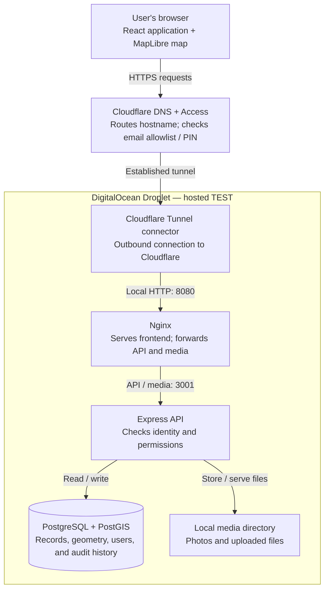
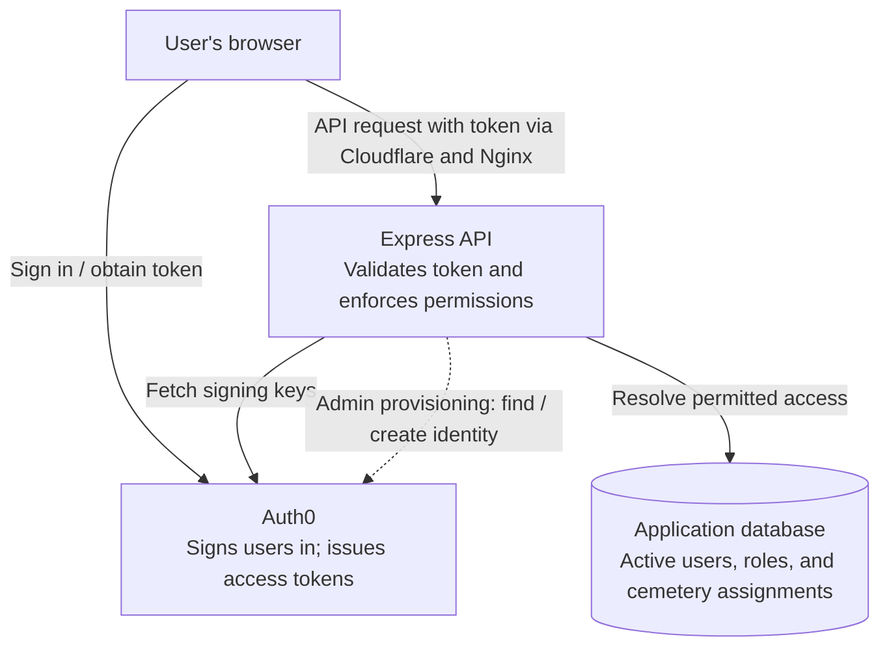
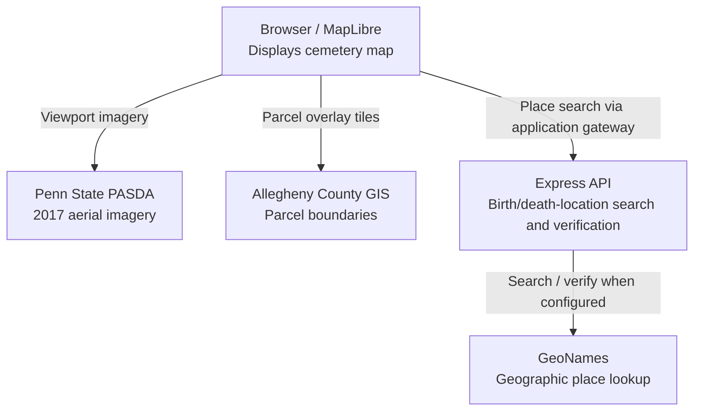
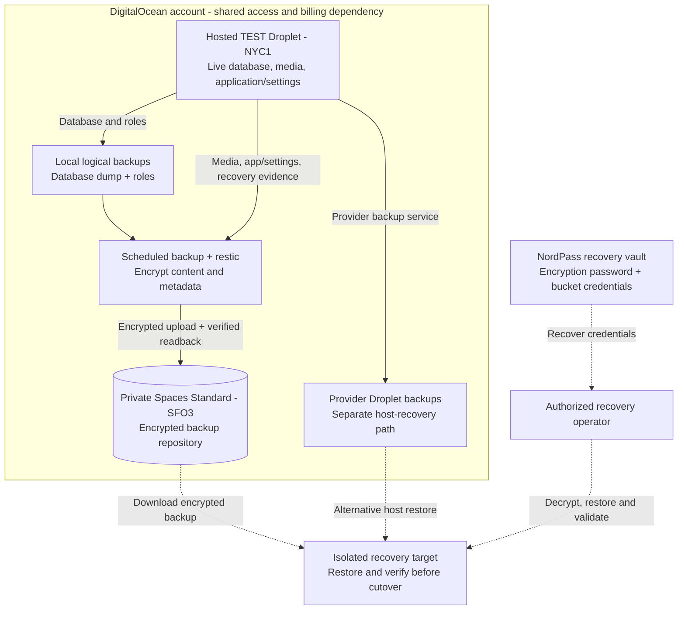
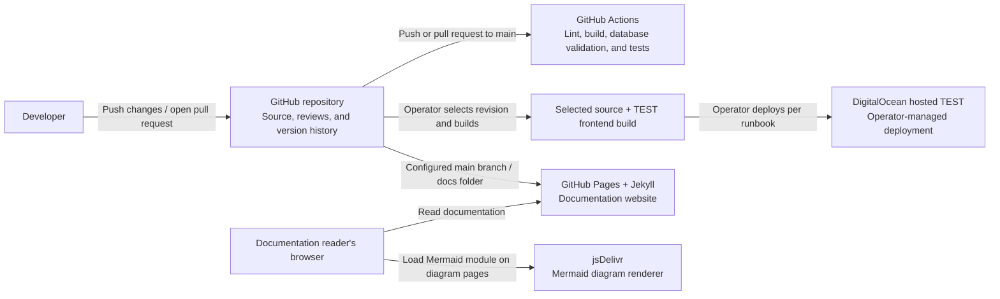

---
---

# Application and Third-Party Services

This overview describes the services connected to Cemetery Mapping, based on the
repository configuration and the [Hosted TEST runbook](hosted-test.md). The hosting
diagram represents **hosted TEST** at `test.nhcemeteries.org`; it is not a claim
that STAGE or PROD is deployed. Local DEV runs the frontend, API, database, and
media locally without the hosted Cloudflare gateway.

Reconciled November 17, 2026 against committed configuration and the recorded
November 13 backup setup and November 16 deployments. This is documentation
reconciliation, not a new audit of provider settings, backup freshness, billing,
or successor access. Generic relationships belong here; account identifiers,
vault item names and authorized recovery access belong in the private operations
repository.

## Local DEV and TEST operations

The [November 24 verification](hosted-test.md#november-24-2026-runtime-consistency-and-hosted-capacity)
adds managed local services and a maintained parity audit to the recorded
operations. The hosted request/backup relationships below are unchanged; this
update does not re-audit provider accounts or billing.

| Local service | DEV | TEST |
| --- | --- | --- |
| Browser / API | 5173 / 3001 | 5174 / 3003 |
| Frontend | Working-tree Vite / HMR | Dedicated built preview |
| API source | Working tree | Captured with the TEST frontend build |
| Process supervision | Checkout-specific macOS LaunchAgent | Checkout-specific macOS LaunchAgent |

Both local containers use the pinned PostgreSQL 18.6 / PostGIS 3.7.0 image with
legacy TIGER 3.6.4 compatibility, retaining separate existing database volumes.
Local DEV and TEST currently share a media directory; hosted TEST has separate
media storage. Isolate TEST media before mutation tests. User/access records,
Auth0 clients and secrets remain environment-specific. Use the
[managed runtime and parity guide](environment-consistency.md) for startup,
shutdown, private profiles, comparisons and controlled refreshes. A source merge
or Pages publication does not restart these services or deploy hosted TEST.

## Application, hosting, and external data

Arrows show the direction of a request or action; responses return along the same
connection. Dashed arrows show conditional provisioning or operator-led recovery;
the configured daily backup is a separate scheduled operation, not optional
coverage supplied by an application request.

### Hosting and stored records

DigitalOcean provider backups supply a host-recovery route. Separately, the
scheduled backup creates logical database/role dumps and uses restic to encrypt
application/settings, media and recovery material before uploading to private
DigitalOcean Spaces. That off-host workflow was set up and restore-tested on
November 13; see [Backups and recovery](#backups-and-recovery). A full host/media
recovery drill and independent provider/account protection remain separate work.

### Sign-in and application permissions

When configured, the API also asks Auth0 to send password setup emails for newly
created identities. Cloudflare's gateway email allowlist is managed separately
from Auth0 and application permissions.

### Public access-request verification

The public form loads Cloudflare Turnstile only on `/request-access`. Its token
travels to the existing Express submission handler, which calls Siteverify with
its private runtime secret and validates success, action `request_access`, and
an exact environment-specific hostname before storing a request. Nginx/API
attempt limits bound work before verification; PostgreSQL enforces shared hourly
and pending-queue ceilings. A verified request still requires administrator
approval and does not grant cemetery access. See [the access guide](access-requests.md)
and [ADR 0088](adr/0088-access-request-abuse-protection.md).

### External map and place data

Nginx delivers the frontend files to the browser, where React and MapLibre run.
Authenticated browser API calls carry an Auth0 access token through Cloudflare
and Nginx to Express. The database and media directory stay on the Droplet;
Cloudflare and Auth0 do not store the application's cemetery records.

## Backups and recovery

The November 13 setup added encrypted off-host recovery; it did not move live
PostgreSQL data or uploaded photos into object storage. Application reads and
uploads still use the Droplet's database and media directory.

[Open the backup/recovery diagram as SVG](assets/images/backup-recovery.svg).
The graphic is an export of the Mermaid source above for viewing without the
Mermaid CDN; update both when these relationships change.

- **Routine protection:** daily logical dumps/roles and encrypted restic snapshots;
  provider Droplet backups are a distinct recovery route. Local release backups
  are checkpoints, not proof of an independently verified Spaces snapshot.
- **Retention and verification:** the recorded policy keeps 14 days of eligible
  local dumps and 30 daily / 8 weekly / 6 monthly off-host daily snapshots.
  Recovery holds are reviewed separately. Local cleanup requires verified
  decrypted readback and unchanged source checks; do not bypass it for free space.
- **Recovery:** authorized operators need both bucket credentials and the separate
  encryption password, plus a compatible PostgreSQL/PostGIS target and matching
  media/settings. The November 13 isolated database restore passed; it was not a
  complete replacement-host/media drill. A restore is not an automatic cutover.
- **Failure boundaries:** Spaces is separate from the Droplet and region, but
  remains in the same provider account. Vault access must be independently
  recoverable. Scheduled status/logging does not itself send alerts; current
  freshness, provider backups and successor access need operational checks.

See the [backup/retention runbook](backup-retention.md) for scheduling, proof-gated
cleanup and restore commands, and the private operations repository for actual
resource ownership and recovery access. STAGE/PROD backup resources are not
implied by this TEST diagram.

## Service names, relationships, and purposes

| Service | Connects to | Purpose and scope |
| --- | --- | --- |
| **Cloudflare DNS** | Browser → hosted hostname | Routes the TEST hostname to the Cloudflare Tunnel. |
| **Cloudflare edge security** | Visitor requests → Cloudflare → Tunnel/origin | The Free Managed Ruleset, HTTP DDoS protection and Browser Integrity Check filter traffic. The active burst rule blocks a client IP for 10 seconds above 5 requests in 10 seconds to the exact `/api/access-requests` path across the zone. It supplements Access, Turnstile and origin limits; it does not match the form page or its assets. See the [rule and verification record](hosted-test.md#november-9-2026-cloudflare-burst-protection). |
| **Cloudflare Access** | Browser → application gateway | Checks the hosted TEST email allowlist using an emailed one-time PIN before allowing protected traffic. This is separate from Auth0 login. |
| **Cloudflare Turnstile** | Public form → widget; Express → Siteverify | Verifies public access-request submissions. Only the public site key reaches the browser; the private secret stays in the API runtime. |
| **Cloudflare Tunnel** | Cloudflare edge ↔ `cloudflared` → Nginx | The connector establishes an outbound tunnel from the Droplet, allowing Cloudflare to reach the loopback web listener without exposing public web or database ports. |
| **DigitalOcean Droplet** | Hosts Nginx, Express, PostgreSQL/PostGIS, media, and the tunnel connector | Keeps hosted TEST available independently of the developer's computer. Docker Compose runs the application services on this server. |
| **DigitalOcean provider backups** | Droplet → provider recovery copies | Host-recovery protection, separate from the logical/restic workflow. Check recent successful provider backups independently. |
| **DigitalOcean Spaces Standard** | Backup job/restic → private object storage | Holds encrypted off-host database/role dumps, media, application/settings and retained recovery evidence. Different region from TEST, but the same DigitalOcean account dependency. It does not serve live application photos. |
| **NordPass recovery vault** | Authorized operator → password vault | Retains independently recoverable backup credentials and the restic encryption password. Not contacted by the application or scheduled backup; the host uses its protected installed credentials. Exact vault item/access information belongs in private operations documentation. |
| **Auth0 Authentication API / Universal Login** | Browser ↔ Auth0; API → Auth0 signing keys | Authenticates application users and issues tokens. Express checks the token's issuer, audience, and signature, then resolves application access from PostgreSQL. |
| **Auth0 Management API** | Express → Auth0 | When server credentials are configured, Admin → Users can find or create an identity in the matching environment's tenant. Hosted TEST has this enabled. |
| **Auth0 email delivery** | Auth0 → user's email inbox | Supports verification and password setup/reset emails. Hosted TEST email configuration is enabled, but real tester delivery still needs verification. The repository does not identify a separate SMTP provider. |
| **Penn State PASDA (ArcGIS REST)** | Browser → `imagery.pasda.psu.edu` | Provides Allegheny County 2017 aerial imagery behind the application's cemetery geometry. Requests pause for hidden maps/Diagram view; identical viewport exports are deduplicated. Genuine failures retain the provider warning and explicit retry. |
| **Allegheny County GIS (ArcGIS REST)** | Browser → `gisdata.alleghenycounty.us` | Provides the parcel boundary overlay. Both map image services are requested directly by the browser, outside the application API. |
| **GeoNames** | Express → `secure.geonames.org` | Searches and verifies geographic places for birth/death-location entry. Requires `GEONAMES_USERNAME`; existing locally verified places remain available if it is absent or the service fails. |

React, MapLibre, Express, Nginx, Docker, PostgreSQL/PostGIS, and Liquibase are
software components or tools, rather than separately hosted application service
accounts. Restic is the backup/encryption client, not another storage provider.
Cron schedules the backup/retention/check commands on the TEST host. Liquibase
applies reviewed database migrations; it does not replace a data backup. MapLibre renders the map in the browser; the external ArcGIS services
supply imagery and parcels, while the application supplies cemetery geometry.
Find a Grave URLs are record links, not an API integration. Imported spreadsheets,
scans, and Esri geodatabases are source files; see the [Data Source Register](data-sources.md).

## How access works

1. **Cloudflare Access admits the visitor to hosted TEST.** The email must be on
   its allowlist. The public access-request page, its assets, and the submission
   endpoint have narrowly scoped exceptions.
2. **Auth0 signs the user into the application.** The browser obtains an access
   token from the environment's Auth0 tenant and includes it in API requests.
3. **Express checks identity and application permissions.** An active `app_users`
   account with `role_name = 'admin'` has system access. Other accounts use each
   membership's role and edit permission for scoped actions and ownership data.
   Passing Cloudflare or signing into Auth0 alone does not grant application
   access. General record reads retain their existing visibility rules.

Non-admin accounts require cemetery membership when created or saved. Admin →
Users manages independent roles for each cemetery; memberships may span several
cemeteries. The map starts at a permitted preferred cemetery or the first assigned
cemetery, and members can choose among their assignments. System admins can see
all cemeteries, with an optional preferred initial scope. The API still enforces
roles for the target cemetery; a map selection is not an authorization grant.
See [profiles and cemetery roles](operator-workflows.md#my-profile).

An administrator approves requests in the application and can provision an Auth0
identity. They must **also add the approved email to Cloudflare Access manually**;
application approval does not synchronize the gateway allowlist. No automatic
email notification to administrators is currently sent for new access requests.
See [Requesting and Approving Access](access-requests.md) for the full workflow.

DEV, TEST, STAGE, and PROD require separate Auth0 tenants and separate application
data and credentials. STAGE and PROD resources must be provisioned before deployment.

## What changes for production?

The expected production baseline uses the same relationships shown above:
Cloudflare routes traffic to the application server, Auth0 handles application
sign-in, and Express accesses PostgreSQL/PostGIS and media. Production hosting
has not yet been provisioned; this is a baseline for planning, not a deployed
production design.

| Area | Hosted TEST today | Production requirement or decision |
| --- | --- | --- |
| Identity and data | Dedicated TEST Auth0 tenant, database, media, and credentials | Provision separate PROD identity settings, database, media, credentials, and hostname. |
| Gateway login | Cloudflare Access email allowlist and one-time PIN, followed by Auth0 login | Decide whether to retain this additional gateway login. Active application accounts and application permissions remain required. |
| Hosting | One DigitalOcean Droplet with Docker Compose | A similar single-server deployment is a possible starting point. Server sizing, managed database, separate media storage, and redundancy remain deployment decisions. |
| Recovery | Provider backups plus encrypted restic backups in Spaces; independently stored recovery credentials | Provision separate PROD backup resources/credentials, address shared-provider/account risk, and rehearse complete database/settings/media restoration before launch. |
| Operations | Persistent hosted testing | Establish monitoring and capacity for production usage; validate releases in TEST and rehearse in STAGE before promotion. |

See [Operator Workflows](operator-workflows.md#environment-promotion-workflow)
and the [Auth0 Production Checklist](auth0-production-checklist.md). Update the
diagram when production deployment decisions are accepted.

## Development and documentation services

These services support development or the documentation website, rather than
handling cemetery API requests.

| Service | Relationship and purpose |
| --- | --- |
| **GitHub repository** | Holds application code, documentation, migrations, and reviewed changes. |
| **GitHub Actions** | Runs CI on pushes and pull requests to `main`, including database rebuild checks and browser tests. The current workflow does not deploy hosted TEST automatically. |
| **GitHub Pages / Jekyll** | The documentation is configured to publish from `main` and `/docs` when enabled in repository settings. This is separate from application hosting. |
| **jsDelivr** | The documentation layout loads Mermaid 10 to render diagrams in the reader's browser. If this CDN cannot load, the Markdown diagram source remains available in the repository. |

## Where to find the implementation

- [Backup/retention runbook](backup-retention.md): Spaces, restic, schedules and recovery verification.
- [Hosted TEST](hosted-test.md) and [ADR 0073](adr/0073-private-hosted-test.md): hosting and environment isolation.
- [Auth0 Test Tenant](auth0-test-tenant.md) and [Auth0 Production Checklist](auth0-production-checklist.md): identity setup.
- [`deploy/test/compose.yaml`](https://github.com/scpeterson/CemeteryMapping/blob/main/deploy/test/compose.yaml) and [`nginx.conf`](https://github.com/scpeterson/CemeteryMapping/blob/main/deploy/test/nginx.conf): server components and routing.
- [`server/auth.mjs`](https://github.com/scpeterson/CemeteryMapping/blob/main/server/auth.mjs) and [`auth0Management.mjs`](https://github.com/scpeterson/CemeteryMapping/blob/main/server/auth0Management.mjs): token validation and identity provisioning.
- [`server/placeSearchService.mjs`](https://github.com/scpeterson/CemeteryMapping/blob/main/server/placeSearchService.mjs): GeoNames requests.
- [`src/components/cemeteryMapLayers.ts`](https://github.com/scpeterson/CemeteryMapping/blob/main/src/components/cemeteryMapLayers.ts): external imagery and parcel requests.
- [CI workflow](https://github.com/scpeterson/CemeteryMapping/blob/main/.github/workflows/ci.yml) and [documentation layout](https://github.com/scpeterson/CemeteryMapping/blob/main/docs/_layouts/default.html): development checks and Mermaid loading.

Update this overview when a service, hosting arrangement, or integration changes.

## Map query ownership resolution

The map gravesite query materializes the current ownership view once per query
and passes that relation into the shared derived-status SQL. It preserves fresh
ownership data and status precedence without a cross-request cache. DEV's
785-record query fell from about 6.3 seconds to 11–31 milliseconds; those are
database timings, not total browser loading times. See
[ADR 0175](adr/0175-map-ownership-query.md).

The lot source includes typed passageways and location evidence. Whole-area
ownership is prohibited for passageways, while individual gravesite rights use
the existing event/party/right architecture. See
[ADR 0178](adr/0178-passageways-and-individual-deeds.md).

Search uses the same per-query materialization approach for its current-ownership
view, sharing it between status derivation and permission-gated owner-name/date
reasons. Matching, normalization, pagination and privacy gates remain unchanged.
Representative DEV comparisons fell from 7.9–19.6 seconds to 11–171 milliseconds
with exact result equality. These are database query timings; see
[ADR 0180](adr/0180-search-ownership-query.md).
